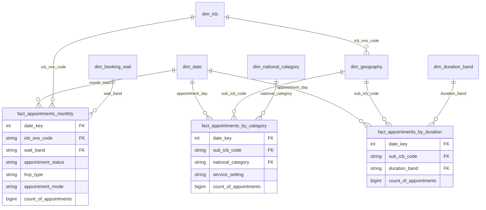
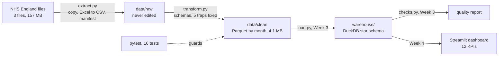

# Star schema design (Week 2)

The warehouse is a star schema in one DuckDB file (built in Week 3). Fact tables hold counts of
appointments; small dimension tables describe them. Rates are never stored: they are calculated at
query time from the counts.

## Fact tables and their grain

| Fact table | Grain: one row is... | Source | Rows | KPIs |
|---|---|---|---|---|
| `fact_appointments_monthly` | the number of appointments for one ICB in one month, with one status, one staff type, one mode and one booking-wait band | regional | 295,692 | 1–8 |
| `fact_appointments_by_category` | the number of appointments for one sub-ICB location on one day, in one service setting and one national category | categories | 817,394 | 9, 10, 12 |
| `fact_appointments_by_duration` | the number of appointments for one sub-ICB location on one day in one duration band | duration | 137,793 | 11, 12 |

Each fact has one measure, `count_of_appointments` (a whole number), and keys to its dimensions.
Totals: 742,804,525, 296,046,770 and 167,980,692.

## Dimensions

| Dimension | One row per | Columns | Used by |
|---|---|---|---|
| `dim_date` | calendar day, Jan 2020 – Jun 2022 | `date_key` (yyyymmdd), `full_date`, `month_start`, `year`, `month`, `month_name`, `weekday_number`, `weekday_name`, `is_weekend` | all three facts (KPI 1, 2, 9) |
| `dim_geography` | sub-ICB location (106 rows, checked) | `sub_icb_code`, `sub_icb_ons_code`, `sub_icb_name`, `icb_ons_code`, `region_ons_code` | category and duration facts |
| `dim_icb` | ICB (42 rows, checked), built from `dim_geography` | `icb_ons_code`, `region_ons_code` | monthly fact (KPI 6) |
| `dim_booking_wait` | wait band (8 rows) | `wait_band`, `sort_order`, `is_known` | monthly fact (KPI 3, 4) |
| `dim_duration_band` | duration band (7 rows) | `duration_band`, `sort_order`, `is_known`, `over_15_minutes` | duration fact (KPI 11, 12) |
| `dim_national_category` | national category (18 rows, checked: each has exactly one context type) | `national_category`, `context_type`, `is_data_quality_issue` | category fact (KPI 12) |

Sort orders: wait bands go Same Day = 1, 1 Day = 2, 2 to 7 Days = 3, 8 to 14 Days = 4,
15 to 21 Days = 5, 22 to 28 Days = 6, More than 28 Days = 7, Unknown / Data Quality = 99.
Duration bands go 1-5 = 1, 6-10 = 2, 11-15 = 3, 16-20 = 4, 21-30 = 5, 31-60 = 6,
Unknown / Data Quality = 99. Without these, `1 Day` sorts before `Same Day` on every chart.

Small sets of values stay as plain columns on their fact tables rather than separate dimensions:
status (Attended, DNA, Unknown), staff type (GP, Other Practice Staff, Unknown), mode
(Face-to-Face, Telephone, Home Visit, Video/Online, Unknown) and service setting (General Practice,
Primary Care Network, Extended Access Provision, Other, Unmapped). KPI 10 filters service setting
for Primary Care Network and Extended Access Provision.

## Design decisions

- **Three facts, not one flat table.** The three files have three grains. A flat table would repeat
  rows when daily sub-ICB data meets monthly ICB data and inflate totals. Full argument in
  `decision_log.md`.
- **Conformed dimensions.** Every fact joins to the same `dim_date`, so KPIs from different facts
  line up by month. The monthly fact joins on `month_start`, the first day of its month.
- **Two levels of geography.** The regional file only has ICB codes, so the monthly fact cannot join
  to a sub-ICB row. `dim_icb` is a roll-up of `dim_geography` (one row per ICB), built from it, so
  both levels always agree. Checked: all 42 regional ICBs and all 106 category sub-ICB codes exist
  in the geography built from the duration file.
- **Never join two facts row by row.** To compare files (e.g. regional against categories), first
  sum each fact to month, then compare the monthly totals.
- **Counts, not rates.** A 4% DNA rate in one ICB and 6% in another do not average to 5%.
  Store counts; divide at query time.
- **Unknowns are kept, and flagged.** `is_known` in the band dimensions lets KPI queries leave
  Unknown out of the denominator, as set out in the decision log.

## Entity relationship diagram

## Architecture

`run_pipeline.py` runs the stages in order and stops at the first failure. Each layer reads only the
layer before it. If a layer is wrong, delete it and rebuild it from the layer above.
